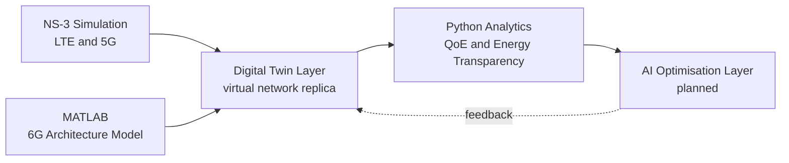

# AI-Native Energy Transparency Framework for Green Digital Twin 6G Networks

A research framework that combines multi-generation network simulation, conceptual 6G modelling and a Digital Twin layer to study **energy efficiency, transparency and AI-native intelligence** in next-generation mobile networks.

The work builds on LTE and 5G simulations in **NS-3** and a conceptual **6G architecture model in MATLAB**, guided by global 6G research initiatives such as **Hexa-X-II** and the **Next G Alliance**.

---

## Table of Contents

- [Overview](#overview)
- [Objectives](#objectives)
- [System Architecture](#system-architecture)
- [Tech Stack](#tech-stack)
- [Methodology](#methodology)
- [Key Features](#key-features)
- [Results and Insights](#results-and-insights)
- [Repository Structure](#repository-structure)
- [Getting Started](#getting-started)
- [Future Work](#future-work)
- [References](#references)
- [Author](#author)
- [Acknowledgement](#acknowledgement)

---

## Overview

Mobile networks consume a growing share of global energy, yet operators and users have little visibility into **where that energy goes and why**. 6G is expected to be *AI-native*, with intelligence built into the network rather than added on top.

This project explores how a **Digital Twin**, a continuously updated virtual replica of the network, can provide that visibility. It does so by:

1. establishing **performance baselines** for LTE and 5G through simulation,
2. modelling a **conceptual 6G architecture**, and
3. designing a **Digital Twin layer** that monitors network behaviour, Quality of Experience (QoE) and energy use, laying the foundation for **AI-driven energy optimisation**.

---

## Objectives

- Analyse the performance of existing **LTE and 5G** networks through simulation.
- Design a **conceptual 6G network architecture** aligned with current research directions.
- Implement a **Digital Twin framework** for real-time network monitoring.
- Evaluate **QoE and energy-transparency** aspects across network generations.
- Explore **AI-driven optimisation** for energy-efficient networks.

---

## System Architecture



| Layer | Role |
|---|---|
| **Simulation (NS-3)** | Generates LTE and 5G network behaviour and performance logs |
| **6G Modelling (MATLAB)** | Models a conceptual 6G architecture for comparison |
| **Digital Twin** | Maintains a virtual replica of the network for monitoring |
| **Analytics (Python)** | Processes logs to evaluate QoE and energy transparency |
| **AI Optimisation** | Planned layer for intelligent, energy-aware network control |

---

## Tech Stack

| Tool | Purpose |
|---|---|
| **NS-3** | LTE and 5G network simulation |
| **MATLAB** | Conceptual 6G architecture modelling |
| **Python** | QoE analysis, log processing and data handling |
| **AI/ML** | Foundation for the future optimisation layer |

---

## Methodology

1. **LTE baseline:** simulated an LTE network in NS-3 and collected performance logs.
2. **5G comparison:** simulated a 5G network and compared key performance metrics against LTE.
3. **6G modelling:** built a conceptual 6G architecture model in MATLAB.
4. **Digital Twin design:** designed a Digital Twin layer to replicate and monitor network behaviour virtually.
5. **QoE and energy analysis:** analysed QoE and energy-transparency aspects across all three generations.

---

## Key Features

- **Multi-generation simulation:** LTE → 5G → 6G in a single, comparable workflow.
- **Green communication focus:** energy efficiency and transparency treated as first-class metrics.
- **AI-native design:** architecture prepared for AI-driven optimisation.
- **Digital Twin monitoring:** virtual replication of the network for real-time insight.
- **QoE-based evaluation:** performance judged by user experience, not throughput alone.

---

## Results and Insights

- Established **baseline performance** for LTE and 5G systems.
- Identified key **energy-transparency challenges** in modern mobile networks.
- Proposed a **Digital Twin-based monitoring approach** to address them.
- Demonstrated the potential of **AI-driven network optimisation** for future 6G systems.

---

## Repository Structure

```
.
├── ns3-simulations/
│   ├── LTE/            # LTE simulation scripts and logs
│   └── 5G/             # 5G simulation scripts and logs
├── matlab-6g-model/    # Conceptual 6G architecture model
├── qoe-analysis/       # Python scripts for QoE and energy analysis
├── docs/               # Reports, diagrams and supporting documents
└── README.md
```

---

## Getting Started

### Prerequisites

- **NS-3** with the LTE module (and 5G support for the 5G simulations)
- **MATLAB**
- **Python 3**

### Usage

1. **Network simulations:** run the scripts in `ns3-simulations/LTE/` and `ns3-simulations/5G/` from your NS-3 installation to generate performance logs.
2. **6G model:** open and run the model in `matlab-6g-model/` in MATLAB.
3. **Analysis:** use the scripts in `qoe-analysis/` to process the logs and evaluate QoE and energy transparency.

See `docs/` for detailed reports and diagrams.

---

## Future Work

- Integrating **Reconfigurable Intelligent Surfaces (RIS/IRS)** into the 6G model.
- Implementing **AI-based traffic prediction** for proactive energy management.
- Simulating **6G use cases** such as massive IoT, autonomous systems and holographic communication.
- Building a **real-time Digital Twin dashboard**.
- Exploring **terahertz (THz) communication** models.

---

## References

- [Hexa-X-II](https://hexa-x-ii.eu/): European flagship 6G research initiative
- [Next G Alliance](https://nextgalliance.org/): North American 6G initiative
- [3GPP](https://www.3gpp.org/): mobile communication standards and specifications
- Recent peer-reviewed research on 6G networks, Digital Twins and green communication

---

## Author

**Arav Upadhyay**
B.Tech, Electronics and Communication Engineering (Minor in AI and Machine Learning)
Symbiosis Institute of Technology, Pune

[LinkedIn](https://www.linkedin.com/in/arav-upadhyay-7b50a8209/) · [GitHub](https://github.com/flasharav)

---

## Acknowledgement

This project was carried out as part of the B.Tech curriculum at Symbiosis Institute of Technology, Pune, with a focus on emerging technologies in 6G communication systems.
